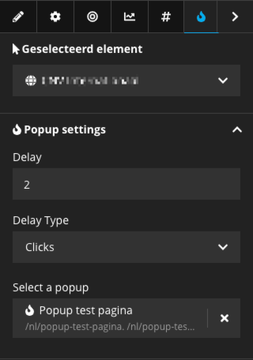

# UpAssist.PopUp

## Description
A popup implementation for Neos.
Currently supports one popup registering per page, but multiple popups can be registered over multiple pages.
Currently supports two types of pupop triggering: after X seconds or after X clicks.

## Compatibility

| Version | Neos |
| --- | --- |
| 7.2.4 and up | 8.3, 8.4, 9.0, 9.1, 9.2 |
| up to 7.2.3 | untested constraint `*` |

## Installation
Run `composer require upassist/popup` in your distribution package, or require `"upassist/popup": "^7.2"` in your site package.

## Configuration
Take a look at the Fusion files for configuring styles and js loading.
The stylesheet and the (deferred) script are added to `head` of `Neos.Neos:Page`, so they also load when your site replaces `body`.
Add the mixin NodeType to the page you want to be able to add a popup too.

